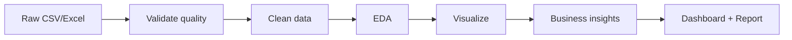
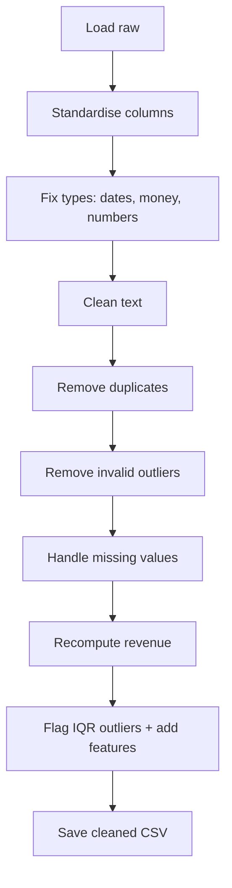

# Project Documentation - Retail Sales Data Analysis System

## 1. Data Analysis Workflow


## 2. Data Cleaning Process Flow


## 3. EDA Workflow
Descriptive statistics -> distributions (histogram, boxplot) -> correlations (heatmap) -> trends
(monthly, YoY) -> segment analysis (product, region, category, customer) -> insights.

## 4. NumPy array structure
A NumPy `ndarray` is a fixed-type, contiguous block of memory with a `shape`.
```
shape (3, 4)   axis 1 ->
 [[ 1  2  3  4]     axis 0
  [ 5  6  7  8]       |
  [ 9 10 11 12]]      v
```
Operations are vectorised and broadcast across axes (see notebook 00, Part D).

## 5. Pandas DataFrame structure
```
            order_id | order_date | region | category | quantity | revenue   <- columns (Series)
index 0     ORD-100000 ...
index 1     ORD-100001 ...                                                  <- rows
```
A DataFrame is a labelled 2-D table: each column is a `Series` with its own dtype.

## 6. Folder structure
See `README.md`.

## 7. Dashboard screenshots
Add screenshots of `dashboard/dashboard.html` here (KPI cards, trend with region dropdown, product,
region, category, heatmap, customers, box plot, growth chart).

## 8. Internship roadmap
Task 1 Python/Pandas/EDA -> Task 2 SQL, advanced Pandas, feature engineering -> Task 3 Power BI/Tableau
-> Task 4 Machine Learning -> Task 5 Streamlit app -> Task 6 cloud deployment (capstone).
