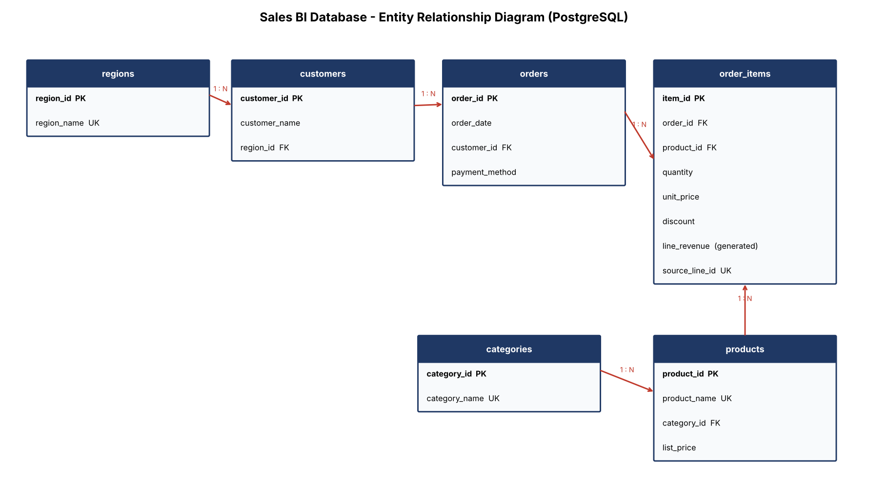
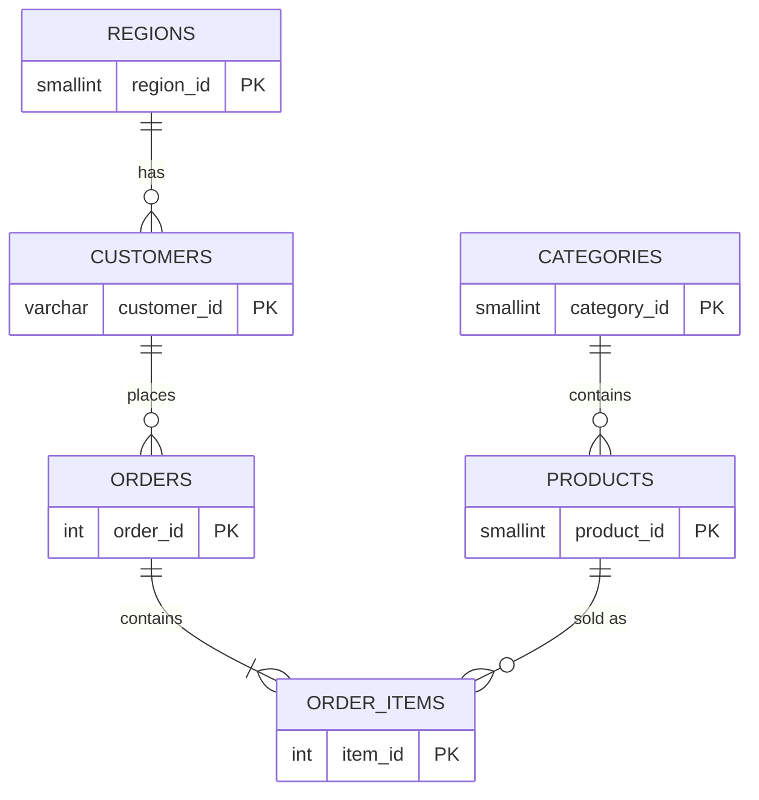
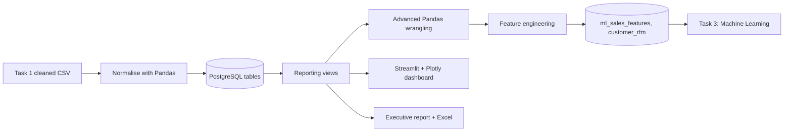
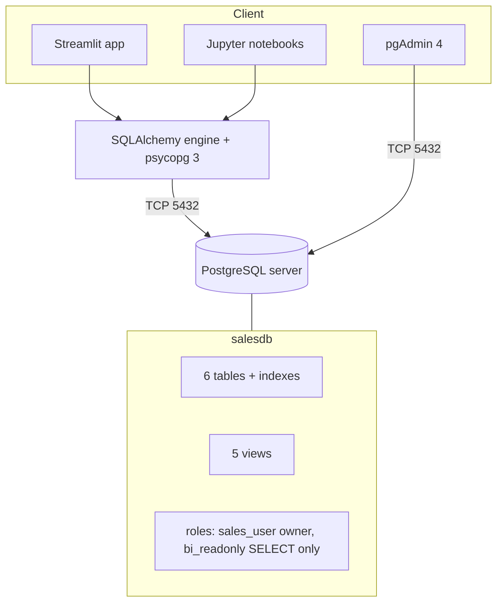
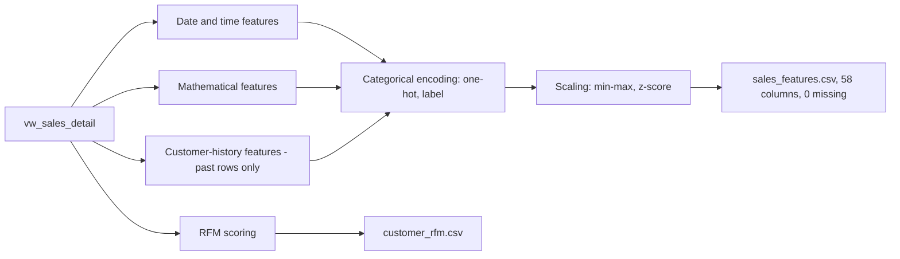
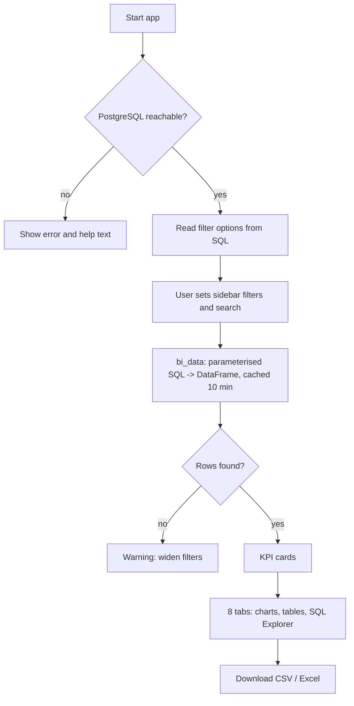
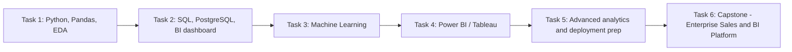

# Task 2 - Project Documentation: BI Sales Analytics Dashboard

## 1. SQL Database Schema (ER Diagram)




| Table | Rows | Purpose |
|---|---|---|
| regions | 5 | Sales regions |
| categories | 5 | Product categories |
| customers | 292 | Customer master data (belongs to one region) |
| products | 20 | Product catalogue (belongs to one category) |
| orders | 5,825 | One order = one customer, one day, one payment method |
| order_items | 5,905 | Order lines; `line_revenue` is a generated column |

**Design decisions**
- Normalised (3NF-style): names live once in dimension tables, facts reference them by key; no duplicated region or category text.
- `CHECK` constraints reject impossible data (quantity <= 0, discount >= 100%, price <= 0).
- `line_revenue` is `GENERATED ALWAYS AS (ROUND(quantity * unit_price * (1 - discount), 2)) STORED`: always consistent.
- Indexes on every foreign key and on `order_date` speed up joins and date filters.
- `source_line_id` keeps the original Task 1 order id for traceability.

## 2. Data Pipeline Workflow

One command runs the pipeline: `python scripts/run_pipeline.py`. The load step reconciles database revenue against the source file (difference <= $1 over $1.52M, caused by half-cent rounding differences between Python and PostgreSQL).

## 3. PostgreSQL Architecture (as used here)


## 4. Feature Engineering Process

| Group | Features | Reason |
|---|---|---|
| Date / time | week, day of month, weekend, month end, holiday season, month sin/cos, days since start | Captures seasonality; sin/cos makes December neighbour January |
| Mathematical | gross amount, discount amount, log revenue, price tier, bulk flag | `log1p` cuts skewness from 3.0 to 0.2 |
| Customer history | purchase sequence, days since previous purchase, revenue before, previous-3 average | Behaviour signals; computed with `shift` so no future data leaks |
| Encoding | one-hot category, region, payment; label-encoded product | Models need numbers |
| Scaling | min-max and z-score of quantity, price, discount, revenue | Comparable ranges for distance-based models |

## 5. KPI Dashboard Layout
```
+--------------------------------------------------------------+
| Sidebar: date range | region | category | payment | search     |
+--------------------------------------------------------------+
| [Revenue]  [Orders]  [Customers]  [Avg order value] [Units]   |  <- KPI cards (delta vs previous period)
+--------------------------------------------------------------+
| Overview | Revenue | Customers | Products | Regions | Trends |  |
| SQL Explorer | Data & Export                                  |
+--------------------------------------------------------------+
|  Chart area (2-column grid of Plotly charts / tables)         |
+--------------------------------------------------------------+
```
| KPI | Definition |
|---|---|
| Revenue | SUM(quantity x unit_price x (1 - discount)) |
| Orders | COUNT DISTINCT order_id |
| Customers | COUNT DISTINCT customer_id |
| Average order value | Revenue / Orders |
| Units sold | SUM(quantity) |
| Delta | % change vs the equally long period immediately before the selected range |

## 6. Streamlit Application Flow


## 7. Dashboard Screenshots
_Insert your screenshots after running `streamlit run dashboard/app.py`:_
1. Overview tab with KPI cards  2. Customers tab (RFM)  3. Products tab  4. Regions tab  5. SQL Explorer  6. Data & Export

## 8. Folder Structure
```
Data-Science-Internship/
├── Task-2/
├── sales-bi-dashboard/
│   ├── datasets/  database/  notebooks/  scripts/  dashboard/  reports/  visualizations/
│   ├── requirements.txt  README.md  .gitignore  .env.example
└── documentation/
```

## 9. Internship Roadmap (Tasks 1-6)

Tasks 4-6 follow the brief's capstone description (Power BI/Tableau, machine learning, cloud deployment); check your internship portal for the exact titles.

## 10. Security and Quality Practices Applied
- Credentials in `.env` (git-ignored); `.env.example` committed
- Bound SQL parameters everywhere user input appears (tested against an injection string)
- Optional read-only database role for the dashboard
- Raw, source, processed and database data kept in separate places
- Reconciliation check after loading; zero missing values in outputs
- Documented SQL queries and a restorable database backup
