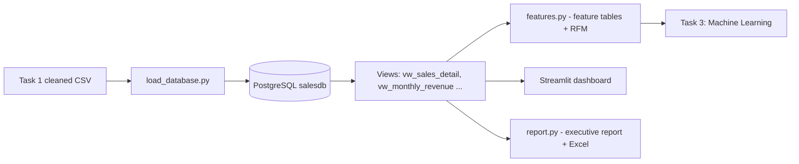
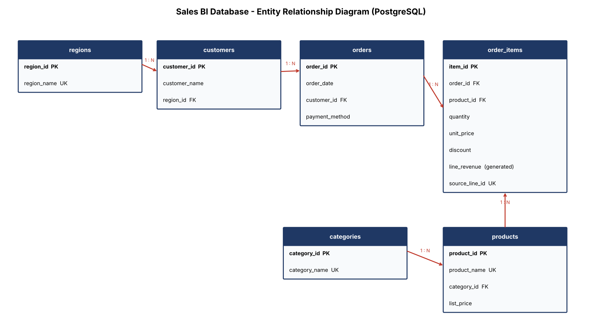

# Business Intelligence Sales Analytics Dashboard

A PostgreSQL-backed BI platform: a normalised sales database, advanced SQL analytics, engineered
ML-ready features, RFM customer segmentation, and an interactive **Streamlit + Plotly** dashboard with
filters, search and Excel/CSV export. Built for **Task 2 - SQL for Data Analytics, Advanced Pandas,
Feature Engineering & BI Dashboards**. It continues the Task 1 *Retail Sales Analysis* project: the same
cleaned data is now loaded into a relational database.

## Features
- **PostgreSQL backend:** 6 normalised tables, primary/foreign keys, CHECK constraints, indexes, a generated revenue column, 5 reporting views, a read-only role
- **12 documented SQL queries:** joins, subqueries, CTEs, window functions, FILTER, UNION, EXPLAIN ANALYZE
- **Advanced Pandas:** MultiIndex, merge/join/concat, pivot, crosstab, apply/lambda, rolling windows, reshaping, data integration
- **Feature engineering:** 58-column ML-ready table (date/time, maths, customer-history, encoding, scaling) with no leakage
- **Customer segmentation:** RFM scores and 5 named segments
- **Dashboard (8 tabs):** Overview, Revenue, Customers, Products, Regions, Trends, SQL Explorer, Data & Export
- **KPI cards** with change vs the previous period, sidebar filters (date, region, category, payment), text search
- **Exports:** filtered CSV and a formatted multi-sheet Excel report; auto-generated executive report

## Architecture


## Database schema


`regions` 1-N `customers` 1-N `orders` 1-N `order_items` N-1 `products` N-1 `categories`.
`order_items.line_revenue` is a **generated column** `ROUND(quantity * unit_price * (1 - discount), 2)`,
so revenue always matches its inputs.

## Project structure
```
sales-bi-dashboard/
├── datasets/source/        retail_sales_clean.csv (from Task 1)
├── datasets/processed/     sales_features.csv, customer_rfm.csv (ML-ready, for Task 3)
├── database/
│   ├── schema.sql          tables, keys, constraints, indexes
│   ├── views.sql           5 reporting views
│   ├── roles.sql           read-only role for the dashboard
│   ├── queries/            12 analytical SQL files
│   ├── salesdb_backup.sql  full PostgreSQL backup (restorable)
│   └── backup_restore.md
├── scripts/                config, db, load_database, wrangling, features, bi_data, viz, report, make_charts, run_pipeline
├── notebooks/              01 SQL, 02 Advanced Pandas, 03 Features & BI
├── dashboard/              app.py (Streamlit), dashboard_preview.html (static snapshot)
├── reports/                executive_report.md, sales_report.xlsx
├── visualizations/         ER diagram + 8 PNG charts
├── requirements.txt  .env.example  .gitignore  README.md
```

## Setup
1. **Install PostgreSQL + pgAdmin 4** (see `documentation/TASK2_STEP_BY_STEP_GUIDE.md`, Step 1).
2. **Create the database** in psql or pgAdmin:
   ```sql
   CREATE ROLE sales_user WITH LOGIN PASSWORD 'your_password' CREATEDB;
   CREATE DATABASE salesdb OWNER sales_user;
   ```
3. **Python environment and credentials**
   ```bash
   python -m venv .venv && source .venv/bin/activate      # Windows: .venv\Scripts\activate
   pip install -r requirements.txt
   cp .env.example .env        # then edit .env with your password (never commit .env)
   ```
4. **Build everything and start the dashboard**
   ```bash
   python scripts/run_pipeline.py        # database -> features -> reports -> charts
   streamlit run dashboard/app.py
   ```
   Or restore the supplied backup instead: `psql -d salesdb -f database/salesdb_backup.sql`.

## Dashboard overview
| Tab | What it answers |
|---|---|
| Overview | Monthly revenue + rolling average, category mix, regional split |
| Revenue | Year-over-year seasonality, category growth, payment mix, discount effect |
| Customers | RFM segments, top customers, Pareto curve, segment drill-down table |
| Products | Top-N products, category treemap, product ranking table |
| Regions | Regional revenue, region x category heatmap, target attainment |
| Trends | Month-over-month growth, day-of-week pattern |
| SQL Explorer | Runs the saved SQL files and shows the code |
| Data & Export | Filtered data table, CSV and Excel download |

_Add your screenshots here:_ ``
(a static snapshot is in `dashboard/dashboard_preview.html`)

## Key insights
- Revenue **$1.52M** from 5,825 orders and 292 customers; **+4.6%** growth 2024 to 2025; average order value **$261**.
- **Champions (79 customers) generate 64%** of revenue; **8 high-value customers have gone quiet** ($49K at risk): win-back target.
- Q4 delivers **33.5%** of revenue; December 2024 was the best month.
- **Home & Kitchen** is the only category with negative growth (-3.2%).
- East leads regions (36.4%); Central is weakest (9.1%).
- An index on `orders.customer_id` cut a lookup from 0.58 ms (Seq Scan) to 0.09 ms (Index Scan).

Full write-up: [`reports/executive_report.md`](reports/executive_report.md).

## Notes and limitations
- The dataset is **synthetic** (generated in Task 1). Treat numbers as illustrative.
- Regional **targets** in the attainment chart are assumptions defined in `scripts/wrangling.py`.
- Each order has mostly one line item, so basket-size features are not included.

## Technologies
PostgreSQL 16, SQL, pgAdmin 4, Python, SQLAlchemy, psycopg 3, Pandas, NumPy, Plotly, Streamlit, Matplotlib, Seaborn, OpenPyXL, Jupyter, Git/GitHub.

## Future improvements
- Task 3: churn and revenue-forecast models using `datasets/processed/sales_features.csv`
- Power BI / Tableau connection to the same PostgreSQL views
- Materialised views and scheduled refresh for larger data
- Streamlit login, Docker Compose deployment (PostgreSQL + app), automated tests
